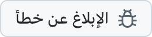
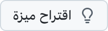

  <picture>
    <source media="(prefers-color-scheme: dark)" srcset="../../assets/app-icon-dark.png">
    
  </picture>

<h1 align="center">super.engineering</h1>

تقارير الأخطاء واقتراحات الميزات لتطبيق super.engineering.

  
  

<a href="https://super.engineering">super.engineering</a> هي مساحة العمل الأصلية للهندسة القائمة على الوكلاء. يجمع وكلاء البرمجة والطرفيات والمراجعات في تطبيق واحد فائق السرعة مبني بلغة Rust. أخبرنا بما يتعطل وبما تحتاجه بعد ذلك.

  <a href="https://github.com/superdoteng/super.engineering/issues/new?template=bug.yml"><picture><source media="(prefers-color-scheme: dark)" srcset="../../assets/buttons/bug-ar-dark.png"></picture></a>
  <a href="https://github.com/superdoteng/super.engineering/issues/new?template=feature.yml"><picture><source media="(prefers-color-scheme: dark)" srcset="../../assets/buttons/feature-ar-dark.png"></picture></a>

<h2>ما الذي ينبغي تضمينه؟</h2>

هل تستعين بوكيل؟ اقرأ <a href="../../AGENTS.md">دليل الوكلاء</a>.

<a href="https://github.com/superdoteng/super.engineering/issues">ابحث في البلاغات الموجودة</a> أولًا. أضف التفاصيل المفيدة إلى البلاغ المشابه.

<ul>
  <li><strong>خطأ:</strong> خطوات إعادة حدوث المشكلة، وما توقعته، وما حدث فعلًا. إن أمكن، أضف إصدار التطبيق من «حول super.engineering» ونظام التشغيل لديك.</li>
  <li><strong>ميزة:</strong> المهمة التي تريد إنجازها، وما يعوقك، والنتيجة التي تحتاجها.</li>
  <li><strong>السجلات ولقطات الشاشة:</strong> اختيارية. تحقق أولًا من خلوها من المعلومات الخاصة، أو أرسلها إلى <a href="mailto:humans@super.engineering">humans@super.engineering</a>.</li>
</ul>

<h2>هل تحتاج إلى مساعدة؟</h2>

اطرح الأسئلة وشارك الأفكار على <a href="https://discord.gg/AJ5BUZSV65">ديسكورد</a>. 
أبلغ عن المشكلات الأمنية بشكل خاص إلى <a href="mailto:humans@super.engineering">humans@super.engineering</a>.

  <strong>العربية</strong> ·
  <a href="bn-BD.md">বাংলা</a> ·
  <a href="de-DE.md">Deutsch</a> ·
  <a href="../../README.md">English</a> ·
  <a href="es-ES.md">Español</a> ·
  <a href="fa-IR.md">فارسی</a> ·
  <a href="fr-FR.md">Français</a> ·
  <a href="he-IL.md">עברית</a> ·
  <a href="hi-IN.md">हिन्दी</a> ·
  <a href="id-ID.md">Bahasa Indonesia</a> ·
  <a href="it-IT.md">Italiano</a> ·
  <a href="ja-JP.md">日本語</a> ·
  <a href="ko-KR.md">한국어</a> ·
  <a href="pt-BR.md">Português (Brasil)</a> ·
  <a href="ru-RU.md">Русский</a> ·
  <a href="tr-TR.md">Türkçe</a> ·
  <a href="ur-PK.md">اردو</a> ·
  <a href="vi-VN.md">Tiếng Việt</a> ·
  <a href="zh-CN.md">简体中文</a> ·
  <a href="zh-TW.md">繁體中文</a>

