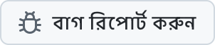

  <picture>
    <source media="(prefers-color-scheme: dark)" srcset="../../assets/app-icon-dark.png">
    
  </picture>

<h1 align="center">super.engineering</h1>

super.engineering-এর জন্য বাগ রিপোর্ট ও ফিচারের অনুরোধ।

  
  

[super.engineering](https://super.engineering) হলো এজেন্টিক ইঞ্জিনিয়ারিংয়ের জন্য নেটিভ ওয়ার্কস্পেস। এটি আপনার কোডিং এজেন্ট, টার্মিনাল আর রিভিউ এক অত্যন্ত দ্রুত অ্যাপে নিয়ে আসে, যা Rust-এ তৈরি। কী ভাঙছে আর এরপর কী দরকার, আমাদের জানান।

  <a href="https://github.com/superdoteng/super.engineering/issues/new?template=bug.yml"><picture><source media="(prefers-color-scheme: dark)" srcset="../../assets/buttons/bug-bn-BD-dark.png"></picture></a>
  <a href="https://github.com/superdoteng/super.engineering/issues/new?template=feature.yml"><picture><source media="(prefers-color-scheme: dark)" srcset="../../assets/buttons/feature-bn-BD-dark.png"></picture></a>

## কী লিখবেন

এজেন্টের সাহায্য নিচ্ছেন? [এজেন্ট নির্দেশিকা](../../AGENTS.md) পড়ুন।

[বিদ্যমান ইস্যুগুলো খুঁজুন](https://github.com/superdoteng/super.engineering/issues) প্রথমে। মিল থাকা রিপোর্টে দরকারি তথ্য যোগ করুন।

- **বাগ:** সমস্যাটি আবার ঘটানোর ধাপ, আপনার প্রত্যাশা এবং আসলে কী ঘটেছে। সম্ভব হলে “super.engineering সম্পর্কে” থেকে অ্যাপের সংস্করণ এবং আপনার অপারেটিং সিস্টেম লিখুন।
- **ফিচার:** আপনার কাজ, কী বাধা হচ্ছে এবং কী ফলাফল দরকার।
- **লগ ও স্ক্রিনশট:** ঐচ্ছিক। আগে দেখে নিন এতে ব্যক্তিগত তথ্য নেই, অথবা [humans@super.engineering](mailto:humans@super.engineering) ঠিকানায় ইমেইল করুন।

## সাহায্য দরকার?

[Discord](https://discord.gg/AJ5BUZSV65)-এ প্রশ্ন করুন আর আইডিয়া শেয়ার করুন।\
নিরাপত্তা সমস্যা ব্যক্তিগতভাবে [humans@super.engineering](mailto:humans@super.engineering) ঠিকানায় জানান।

  <a href="ar.md">العربية</a> ·
  <strong>বাংলা</strong> ·
  <a href="de-DE.md">Deutsch</a> ·
  <a href="../../README.md">English</a> ·
  <a href="es-ES.md">Español</a> ·
  <a href="fa-IR.md">فارسی</a> ·
  <a href="fr-FR.md">Français</a> ·
  <a href="he-IL.md">עברית</a> ·
  <a href="hi-IN.md">हिन्दी</a> ·
  <a href="id-ID.md">Bahasa Indonesia</a> ·
  <a href="it-IT.md">Italiano</a> ·
  <a href="ja-JP.md">日本語</a> ·
  <a href="ko-KR.md">한국어</a> ·
  <a href="pt-BR.md">Português (Brasil)</a> ·
  <a href="ru-RU.md">Русский</a> ·
  <a href="tr-TR.md">Türkçe</a> ·
  <a href="ur-PK.md">اردو</a> ·
  <a href="vi-VN.md">Tiếng Việt</a> ·
  <a href="zh-CN.md">简体中文</a> ·
  <a href="zh-TW.md">繁體中文</a>

