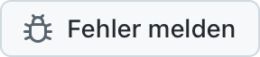
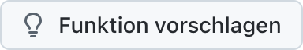

  <picture>
    <source media="(prefers-color-scheme: dark)" srcset="../../assets/app-icon-dark.png">
    
  </picture>

<h1 align="center">super.engineering</h1>

Fehlerberichte und Funktionswünsche für super.engineering.

  
  

[super.engineering](https://super.engineering) ist der native Workspace für Agentic Engineering. Er vereint deine Coding-Agenten, Terminals und Reviews in einer rasend schnellen App, gebaut in Rust. Sag uns, was nicht funktioniert und was du als Nächstes brauchst.

  <a href="https://github.com/superdoteng/super.engineering/issues/new?template=bug.yml"><picture><source media="(prefers-color-scheme: dark)" srcset="../../assets/buttons/bug-de-DE-dark.png"></picture></a>
  <a href="https://github.com/superdoteng/super.engineering/issues/new?template=feature.yml"><picture><source media="(prefers-color-scheme: dark)" srcset="../../assets/buttons/feature-de-DE-dark.png"></picture></a>

## Was gehört in den Bericht?

Du nutzt einen Agenten? Lies den [Leitfaden für Agenten](../../AGENTS.md).

[Suche zuerst nach bestehenden Issues](https://github.com/superdoteng/super.engineering/issues). Ergänze hilfreiche Details in einem passenden Bericht.

- **Fehler:** Schritte zum Reproduzieren, das erwartete und das tatsächliche Verhalten. Wenn möglich, gib die App-Version aus „Über super.engineering“ und dein Betriebssystem an.
- **Funktion:** deine Aufgabe, was dich dabei hindert und welches Ergebnis du brauchst.
- **Logs und Screenshots:** optional. Prüfe sie vorher auf private Informationen oder schick sie an [humans@super.engineering](mailto:humans@super.engineering).

## Du brauchst Hilfe?

Stell Fragen und teile Ideen auf [Discord](https://discord.gg/AJ5BUZSV65).\
Melde Sicherheitsprobleme vertraulich an [humans@super.engineering](mailto:humans@super.engineering).

  <a href="ar.md">العربية</a> ·
  <a href="bn-BD.md">বাংলা</a> ·
  <strong>Deutsch</strong> ·
  <a href="../../README.md">English</a> ·
  <a href="es-ES.md">Español</a> ·
  <a href="fa-IR.md">فارسی</a> ·
  <a href="fr-FR.md">Français</a> ·
  <a href="he-IL.md">עברית</a> ·
  <a href="hi-IN.md">हिन्दी</a> ·
  <a href="id-ID.md">Bahasa Indonesia</a> ·
  <a href="it-IT.md">Italiano</a> ·
  <a href="ja-JP.md">日本語</a> ·
  <a href="ko-KR.md">한국어</a> ·
  <a href="pt-BR.md">Português (Brasil)</a> ·
  <a href="ru-RU.md">Русский</a> ·
  <a href="tr-TR.md">Türkçe</a> ·
  <a href="ur-PK.md">اردو</a> ·
  <a href="vi-VN.md">Tiếng Việt</a> ·
  <a href="zh-CN.md">简体中文</a> ·
  <a href="zh-TW.md">繁體中文</a>

