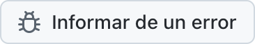
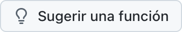

  <picture>
    <source media="(prefers-color-scheme: dark)" srcset="../../assets/app-icon-dark.png">
    
  </picture>

<h1 align="center">super.engineering</h1>

Informes de errores y solicitudes de funciones para super.engineering.

  
  

[super.engineering](https://super.engineering) es el espacio de trabajo nativo para la ingeniería agéntica. Reúne tus agentes de programación, terminales y revisiones en una app ultrarrápida, creada en Rust. Cuéntanos qué falla y qué necesitas a continuación.

  <a href="https://github.com/superdoteng/super.engineering/issues/new?template=bug.yml"><picture><source media="(prefers-color-scheme: dark)" srcset="../../assets/buttons/bug-es-ES-dark.png"></picture></a>
  <a href="https://github.com/superdoteng/super.engineering/issues/new?template=feature.yml"><picture><source media="(prefers-color-scheme: dark)" srcset="../../assets/buttons/feature-es-ES-dark.png"></picture></a>

## Qué incluir

¿Usas un agente? Lee la [guía para agentes](../../AGENTS.md).

[Busca primero en las incidencias existentes](https://github.com/superdoteng/super.engineering/issues). Añade los detalles útiles a un informe que coincida.

- **Error:** pasos para reproducirlo, qué esperabas y qué ocurrió. Si puedes, añade la versión de la app que aparece en «Acerca de super.engineering» y tu sistema operativo.
- **Función:** tu tarea, qué te impide realizarla y el resultado que necesitas.
- **Registros y capturas de pantalla:** opcionales. Revisa primero que no contengan información privada o envíalos a [humans@super.engineering](mailto:humans@super.engineering).

## ¿Necesitas ayuda?

Haz preguntas y comparte ideas en [Discord](https://discord.gg/AJ5BUZSV65).\
Informa de problemas de seguridad en privado a [humans@super.engineering](mailto:humans@super.engineering).

  <a href="ar.md">العربية</a> ·
  <a href="bn-BD.md">বাংলা</a> ·
  <a href="de-DE.md">Deutsch</a> ·
  <a href="../../README.md">English</a> ·
  <strong>Español</strong> ·
  <a href="fa-IR.md">فارسی</a> ·
  <a href="fr-FR.md">Français</a> ·
  <a href="he-IL.md">עברית</a> ·
  <a href="hi-IN.md">हिन्दी</a> ·
  <a href="id-ID.md">Bahasa Indonesia</a> ·
  <a href="it-IT.md">Italiano</a> ·
  <a href="ja-JP.md">日本語</a> ·
  <a href="ko-KR.md">한국어</a> ·
  <a href="pt-BR.md">Português (Brasil)</a> ·
  <a href="ru-RU.md">Русский</a> ·
  <a href="tr-TR.md">Türkçe</a> ·
  <a href="ur-PK.md">اردو</a> ·
  <a href="vi-VN.md">Tiếng Việt</a> ·
  <a href="zh-CN.md">简体中文</a> ·
  <a href="zh-TW.md">繁體中文</a>

