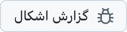

  <picture>
    <source media="(prefers-color-scheme: dark)" srcset="../../assets/app-icon-dark.png">
    
  </picture>

<h1 align="center">super.engineering</h1>

گزارش اشکال و پیشنهاد قابلیت برای super.engineering.

  
  

<a href="https://super.engineering">super.engineering</a> فضای کاری بومی برای مهندسی عامل‌محور است. عامل‌های برنامه‌نویسی، ترمینال‌ها و بازبینی‌هایتان را در یک برنامهٔ فوق‌العاده سریع که با Rust ساخته شده گرد هم می‌آورد. به ما بگویید چه چیزی خراب می‌شود و بعد به چه چیزی نیاز دارید.

  <a href="https://github.com/superdoteng/super.engineering/issues/new?template=bug.yml"><picture><source media="(prefers-color-scheme: dark)" srcset="../../assets/buttons/bug-fa-IR-dark.png"></picture></a>
  <a href="https://github.com/superdoteng/super.engineering/issues/new?template=feature.yml"><picture><source media="(prefers-color-scheme: dark)" srcset="../../assets/buttons/feature-fa-IR-dark.png"></picture></a>

<h2>چه بنویسید؟</h2>

از یک عامل کمک می‌گیرید؟ <a href="../../AGENTS.md">راهنمای عامل‌ها</a> را بخوانید.

<a href="https://github.com/superdoteng/super.engineering/issues">ابتدا گزارش‌های موجود را جستجو کنید</a>. اگر مورد مشابهی یافتید، اطلاعات مفید را همان‌جا اضافه کنید.

<ul>
  <li><strong>اشکال:</strong> مراحل بازتولید، نتیجهٔ مورد انتظار و آنچه اتفاق افتاد. اگر می‌توانید، نسخهٔ برنامه را از «دربارهٔ super.engineering» و سیستم‌عامل خود را بنویسید.</li>
  <li><strong>قابلیت:</strong> کاری که می‌خواهید انجام دهید، مانع فعلی و نتیجهٔ دلخواه.</li>
  <li><strong>لاگ‌ها و تصاویر:</strong> اختیاری است. ابتدا آن‌ها را از نظر اطلاعات خصوصی بررسی کنید یا به <a href="mailto:humans@super.engineering">humans@super.engineering</a> ایمیل بزنید.</li>
</ul>

<h2>کمک می‌خواهید؟</h2>

در <a href="https://discord.gg/AJ5BUZSV65">دیسکورد</a> سؤال بپرسید و ایده‌هایتان را به اشتراک بگذارید. 
مشکلات امنیتی را به‌صورت خصوصی به <a href="mailto:humans@super.engineering">humans@super.engineering</a> گزارش دهید.

  <a href="ar.md">العربية</a> ·
  <a href="bn-BD.md">বাংলা</a> ·
  <a href="de-DE.md">Deutsch</a> ·
  <a href="../../README.md">English</a> ·
  <a href="es-ES.md">Español</a> ·
  <strong>فارسی</strong> ·
  <a href="fr-FR.md">Français</a> ·
  <a href="he-IL.md">עברית</a> ·
  <a href="hi-IN.md">हिन्दी</a> ·
  <a href="id-ID.md">Bahasa Indonesia</a> ·
  <a href="it-IT.md">Italiano</a> ·
  <a href="ja-JP.md">日本語</a> ·
  <a href="ko-KR.md">한국어</a> ·
  <a href="pt-BR.md">Português (Brasil)</a> ·
  <a href="ru-RU.md">Русский</a> ·
  <a href="tr-TR.md">Türkçe</a> ·
  <a href="ur-PK.md">اردو</a> ·
  <a href="vi-VN.md">Tiếng Việt</a> ·
  <a href="zh-CN.md">简体中文</a> ·
  <a href="zh-TW.md">繁體中文</a>

