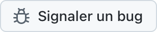

  <picture>
    <source media="(prefers-color-scheme: dark)" srcset="../../assets/app-icon-dark.png">
    
  </picture>

<h1 align="center">super.engineering</h1>

Signalements de bugs et demandes de fonctionnalités pour super.engineering.

  
  

[super.engineering](https://super.engineering) est l'espace de travail natif pour l'ingénierie agentique. Il réunit vos agents de code, terminaux et revues dans une seule app ultra-rapide, développée en Rust. Dites-nous ce qui ne fonctionne pas et ce dont vous avez besoin ensuite.

  <a href="https://github.com/superdoteng/super.engineering/issues/new?template=bug.yml"><picture><source media="(prefers-color-scheme: dark)" srcset="../../assets/buttons/bug-fr-FR-dark.png"></picture></a>
  <a href="https://github.com/superdoteng/super.engineering/issues/new?template=feature.yml"><picture><source media="(prefers-color-scheme: dark)" srcset="../../assets/buttons/feature-fr-FR-dark.png"></picture></a>

## Que faut-il inclure ?

Vous utilisez un agent ? Lisez le [guide pour les agents](../../AGENTS.md).

[Recherchez d’abord les tickets existants](https://github.com/superdoteng/super.engineering/issues). Ajoutez les détails utiles à un signalement correspondant.

- **Bug:** les étapes pour le reproduire, le résultat attendu et ce qui s’est passé. Si possible, indiquez la version de l’app affichée dans « À propos de super.engineering » et votre système d’exploitation.
- **Fonctionnalité:** votre tâche, ce qui vous bloque et le résultat souhaité.
- **Journaux et captures d’écran:** facultatifs. Vérifiez d’abord qu’ils ne contiennent pas d’informations privées, ou envoyez-les à [humans@super.engineering](mailto:humans@super.engineering).

## Besoin d’aide ?

Posez vos questions et partagez vos idées sur [Discord](https://discord.gg/AJ5BUZSV65).\
Signalez les problèmes de sécurité en privé à [humans@super.engineering](mailto:humans@super.engineering).

  <a href="ar.md">العربية</a> ·
  <a href="bn-BD.md">বাংলা</a> ·
  <a href="de-DE.md">Deutsch</a> ·
  <a href="../../README.md">English</a> ·
  <a href="es-ES.md">Español</a> ·
  <a href="fa-IR.md">فارسی</a> ·
  <strong>Français</strong> ·
  <a href="he-IL.md">עברית</a> ·
  <a href="hi-IN.md">हिन्दी</a> ·
  <a href="id-ID.md">Bahasa Indonesia</a> ·
  <a href="it-IT.md">Italiano</a> ·
  <a href="ja-JP.md">日本語</a> ·
  <a href="ko-KR.md">한국어</a> ·
  <a href="pt-BR.md">Português (Brasil)</a> ·
  <a href="ru-RU.md">Русский</a> ·
  <a href="tr-TR.md">Türkçe</a> ·
  <a href="ur-PK.md">اردو</a> ·
  <a href="vi-VN.md">Tiếng Việt</a> ·
  <a href="zh-CN.md">简体中文</a> ·
  <a href="zh-TW.md">繁體中文</a>

