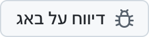

  <picture>
    <source media="(prefers-color-scheme: dark)" srcset="../../assets/app-icon-dark.png">
    
  </picture>

<h1 align="center">super.engineering</h1>

דיווחי באגים ובקשות לתכונות עבור super.engineering.

  
  

<a href="https://super.engineering">super.engineering</a> היא סביבת העבודה הנייטיבית להנדסה מבוססת סוכנים. היא מאחדת את סוכני הקוד, הטרמינלים והסקירות שלכם באפליקציה אחת מהירה במיוחד, שנבנתה ב־Rust. ספרו לנו מה לא עובד ומה אתם צריכים בהמשך.

  <a href="https://github.com/superdoteng/super.engineering/issues/new?template=bug.yml"><picture><source media="(prefers-color-scheme: dark)" srcset="../../assets/buttons/bug-he-IL-dark.png"></picture></a>
  <a href="https://github.com/superdoteng/super.engineering/issues/new?template=feature.yml"><picture><source media="(prefers-color-scheme: dark)" srcset="../../assets/buttons/feature-he-IL-dark.png"></picture></a>

<h2>מה לכלול</h2>

נעזרים בסוכן? קראו את <a href="../../AGENTS.md">המדריך לסוכנים</a>.

<a href="https://github.com/superdoteng/super.engineering/issues">חפשו קודם בדיווחים הקיימים</a>. הוסיפו פרטים מועילים לדיווח מתאים.

<ul>
  <li><strong>באג:</strong> שלבים לשחזור, מה ציפיתם שיקרה ומה קרה בפועל. אם אפשר, ציינו את גרסת האפליקציה מתוך „מידע על super.engineering” ואת מערכת ההפעלה שלכם.</li>
  <li><strong>תכונה:</strong> המשימה שלכם, מה מפריע לכם לבצע אותה והתוצאה הנחוצה.</li>
  <li><strong>יומנים וצילומי מסך:</strong> רשות. בדקו קודם שאין בהם מידע פרטי, או שלחו אותם אל <a href="mailto:humans@super.engineering">humans@super.engineering</a>.</li>
</ul>

<h2>צריכים עזרה?</h2>

שאלו שאלות ושתפו רעיונות ב־<a href="https://discord.gg/AJ5BUZSV65">Discord</a>. 
דווחו על בעיות אבטחה באופן פרטי אל <a href="mailto:humans@super.engineering">humans@super.engineering</a>.

  <a href="ar.md">العربية</a> ·
  <a href="bn-BD.md">বাংলা</a> ·
  <a href="de-DE.md">Deutsch</a> ·
  <a href="../../README.md">English</a> ·
  <a href="es-ES.md">Español</a> ·
  <a href="fa-IR.md">فارسی</a> ·
  <a href="fr-FR.md">Français</a> ·
  <strong>עברית</strong> ·
  <a href="hi-IN.md">हिन्दी</a> ·
  <a href="id-ID.md">Bahasa Indonesia</a> ·
  <a href="it-IT.md">Italiano</a> ·
  <a href="ja-JP.md">日本語</a> ·
  <a href="ko-KR.md">한국어</a> ·
  <a href="pt-BR.md">Português (Brasil)</a> ·
  <a href="ru-RU.md">Русский</a> ·
  <a href="tr-TR.md">Türkçe</a> ·
  <a href="ur-PK.md">اردو</a> ·
  <a href="vi-VN.md">Tiếng Việt</a> ·
  <a href="zh-CN.md">简体中文</a> ·
  <a href="zh-TW.md">繁體中文</a>

