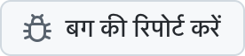
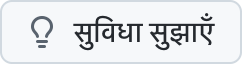

  <picture>
    <source media="(prefers-color-scheme: dark)" srcset="../../assets/app-icon-dark.png">
    
  </picture>

<h1 align="center">super.engineering</h1>

super.engineering के लिए बग रिपोर्ट और नई सुविधाओं के अनुरोध।

  
  

[super.engineering](https://super.engineering) एजेंटिक इंजीनियरिंग के लिए नेटिव वर्कस्पेस है। यह आपके कोडिंग एजेंट, टर्मिनल और रिव्यू को Rust में बने एक बेहद तेज़ ऐप में साथ लाता है। हमें बताएँ कि क्या ठीक से काम नहीं कर रहा और आगे आपको क्या चाहिए।

  <a href="https://github.com/superdoteng/super.engineering/issues/new?template=bug.yml"><picture><source media="(prefers-color-scheme: dark)" srcset="../../assets/buttons/bug-hi-IN-dark.png"></picture></a>
  <a href="https://github.com/superdoteng/super.engineering/issues/new?template=feature.yml"><picture><source media="(prefers-color-scheme: dark)" srcset="../../assets/buttons/feature-hi-IN-dark.png"></picture></a>

## क्या शामिल करें

एजेंट की मदद ले रहे हैं? [एजेंट गाइड](../../AGENTS.md) पढ़ें।

[पहले मौजूदा इश्यू खोजें](https://github.com/superdoteng/super.engineering/issues)। मिलती-जुलती रिपोर्ट हो तो उसमें उपयोगी जानकारी जोड़ें।

- **बग:** समस्या दोहराने के चरण, आपकी अपेक्षा और असल में क्या हुआ। हो सके तो “super.engineering के बारे में” से ऐप का संस्करण और अपना ऑपरेटिंग सिस्टम भी लिखें।
- **सुविधा:** आपका काम, उसमें आने वाली बाधा और आपको जिस परिणाम की ज़रूरत है।
- **लॉग और स्क्रीनशॉट:** वैकल्पिक। पहले जाँच लें कि उनमें निजी जानकारी न हो, या उन्हें [humans@super.engineering](mailto:humans@super.engineering) पर ईमेल करें।

## मदद चाहिए?

[Discord](https://discord.gg/AJ5BUZSV65) पर सवाल पूछें और अपने विचार साझा करें।\
सुरक्षा से जुड़ी समस्याएँ निजी तौर पर [humans@super.engineering](mailto:humans@super.engineering) पर बताएँ।

  <a href="ar.md">العربية</a> ·
  <a href="bn-BD.md">বাংলা</a> ·
  <a href="de-DE.md">Deutsch</a> ·
  <a href="../../README.md">English</a> ·
  <a href="es-ES.md">Español</a> ·
  <a href="fa-IR.md">فارسی</a> ·
  <a href="fr-FR.md">Français</a> ·
  <a href="he-IL.md">עברית</a> ·
  <strong>हिन्दी</strong> ·
  <a href="id-ID.md">Bahasa Indonesia</a> ·
  <a href="it-IT.md">Italiano</a> ·
  <a href="ja-JP.md">日本語</a> ·
  <a href="ko-KR.md">한국어</a> ·
  <a href="pt-BR.md">Português (Brasil)</a> ·
  <a href="ru-RU.md">Русский</a> ·
  <a href="tr-TR.md">Türkçe</a> ·
  <a href="ur-PK.md">اردو</a> ·
  <a href="vi-VN.md">Tiếng Việt</a> ·
  <a href="zh-CN.md">简体中文</a> ·
  <a href="zh-TW.md">繁體中文</a>

