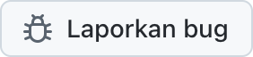

  <picture>
    <source media="(prefers-color-scheme: dark)" srcset="../../assets/app-icon-dark.png">
    
  </picture>

<h1 align="center">super.engineering</h1>

Laporan bug dan permintaan fitur untuk super.engineering.

  
  

[super.engineering](https://super.engineering) adalah ruang kerja native untuk agentic engineering. Aplikasi ini menyatukan agen coding, terminal, dan review Anda dalam satu aplikasi supercepat yang dibangun dengan Rust. Beri tahu kami apa yang rusak dan apa yang Anda butuhkan berikutnya.

  <a href="https://github.com/superdoteng/super.engineering/issues/new?template=bug.yml"><picture><source media="(prefers-color-scheme: dark)" srcset="../../assets/buttons/bug-id-ID-dark.png"></picture></a>
  <a href="https://github.com/superdoteng/super.engineering/issues/new?template=feature.yml"><picture><source media="(prefers-color-scheme: dark)" srcset="../../assets/buttons/feature-id-ID-dark.png"></picture></a>

## Apa yang perlu disertakan

Menggunakan agen? Baca [panduan agen](../../AGENTS.md).

[Cari isu yang sudah ada terlebih dahulu](https://github.com/superdoteng/super.engineering/issues). Tambahkan detail yang berguna pada laporan yang sesuai.

- **Bug:** langkah untuk mengulang masalah, hasil yang diharapkan, dan yang sebenarnya terjadi. Jika bisa, sertakan versi aplikasi dari “Tentang super.engineering” dan sistem operasi Anda.
- **Fitur:** tugas Anda, hambatan yang dihadapi, dan hasil yang dibutuhkan.
- **Log dan tangkapan layar:** opsional. Periksa dulu apakah ada informasi pribadi, atau kirimkan lewat email ke [humans@super.engineering](mailto:humans@super.engineering).

## Perlu bantuan?

Ajukan pertanyaan dan bagikan ide di [Discord](https://discord.gg/AJ5BUZSV65).\
Laporkan masalah keamanan secara pribadi ke [humans@super.engineering](mailto:humans@super.engineering).

  <a href="ar.md">العربية</a> ·
  <a href="bn-BD.md">বাংলা</a> ·
  <a href="de-DE.md">Deutsch</a> ·
  <a href="../../README.md">English</a> ·
  <a href="es-ES.md">Español</a> ·
  <a href="fa-IR.md">فارسی</a> ·
  <a href="fr-FR.md">Français</a> ·
  <a href="he-IL.md">עברית</a> ·
  <a href="hi-IN.md">हिन्दी</a> ·
  <strong>Bahasa Indonesia</strong> ·
  <a href="it-IT.md">Italiano</a> ·
  <a href="ja-JP.md">日本語</a> ·
  <a href="ko-KR.md">한국어</a> ·
  <a href="pt-BR.md">Português (Brasil)</a> ·
  <a href="ru-RU.md">Русский</a> ·
  <a href="tr-TR.md">Türkçe</a> ·
  <a href="ur-PK.md">اردو</a> ·
  <a href="vi-VN.md">Tiếng Việt</a> ·
  <a href="zh-CN.md">简体中文</a> ·
  <a href="zh-TW.md">繁體中文</a>

