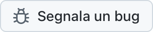

  <picture>
    <source media="(prefers-color-scheme: dark)" srcset="../../assets/app-icon-dark.png">
    
  </picture>

<h1 align="center">super.engineering</h1>

Segnalazioni di bug e richieste di funzionalità per super.engineering.

  
  

[super.engineering](https://super.engineering) è lo spazio di lavoro nativo per l'ingegneria agentica. Riunisce i tuoi agenti di programmazione, terminali e revisioni in un'unica app velocissima, scritta in Rust. Dicci cosa non funziona e di cosa hai bisogno.

  <a href="https://github.com/superdoteng/super.engineering/issues/new?template=bug.yml"><picture><source media="(prefers-color-scheme: dark)" srcset="../../assets/buttons/bug-it-IT-dark.png"></picture></a>
  <a href="https://github.com/superdoteng/super.engineering/issues/new?template=feature.yml"><picture><source media="(prefers-color-scheme: dark)" srcset="../../assets/buttons/feature-it-IT-dark.png"></picture></a>

## Cosa includere

Usi un agente? Leggi la [guida per gli agenti](../../AGENTS.md).

[Cerca prima tra le segnalazioni esistenti](https://github.com/superdoteng/super.engineering/issues). Aggiungi i dettagli utili a una segnalazione corrispondente.

- **Bug:** i passaggi per riprodurlo, il risultato atteso e quello effettivo. Se puoi, indica la versione dell’app da “Informazioni su super.engineering” e il tuo sistema operativo.
- **Funzionalità:** la tua attività, cosa ti ostacola e il risultato di cui hai bisogno.
- **Log e screenshot:** facoltativi. Controlla prima che non contengano informazioni private, oppure inviali a [humans@super.engineering](mailto:humans@super.engineering).

## Hai bisogno di aiuto?

Fai domande e condividi idee su [Discord](https://discord.gg/AJ5BUZSV65).\
Segnala i problemi di sicurezza in privato a [humans@super.engineering](mailto:humans@super.engineering).

  <a href="ar.md">العربية</a> ·
  <a href="bn-BD.md">বাংলা</a> ·
  <a href="de-DE.md">Deutsch</a> ·
  <a href="../../README.md">English</a> ·
  <a href="es-ES.md">Español</a> ·
  <a href="fa-IR.md">فارسی</a> ·
  <a href="fr-FR.md">Français</a> ·
  <a href="he-IL.md">עברית</a> ·
  <a href="hi-IN.md">हिन्दी</a> ·
  <a href="id-ID.md">Bahasa Indonesia</a> ·
  <strong>Italiano</strong> ·
  <a href="ja-JP.md">日本語</a> ·
  <a href="ko-KR.md">한국어</a> ·
  <a href="pt-BR.md">Português (Brasil)</a> ·
  <a href="ru-RU.md">Русский</a> ·
  <a href="tr-TR.md">Türkçe</a> ·
  <a href="ur-PK.md">اردو</a> ·
  <a href="vi-VN.md">Tiếng Việt</a> ·
  <a href="zh-CN.md">简体中文</a> ·
  <a href="zh-TW.md">繁體中文</a>

