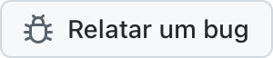

  <picture>
    <source media="(prefers-color-scheme: dark)" srcset="../../assets/app-icon-dark.png">
    
  </picture>

<h1 align="center">super.engineering</h1>

Relatos de bugs e pedidos de funcionalidades para super.engineering.

  
  

[super.engineering](https://super.engineering) é o espaço de trabalho nativo para engenharia agêntica. Ele reúne seus agentes de programação, terminais e revisões em um app ultrarrápido, feito em Rust. Conte para a gente o que quebrou e do que você precisa a seguir.

  <a href="https://github.com/superdoteng/super.engineering/issues/new?template=bug.yml"><picture><source media="(prefers-color-scheme: dark)" srcset="../../assets/buttons/bug-pt-BR-dark.png"></picture></a>
  <a href="https://github.com/superdoteng/super.engineering/issues/new?template=feature.yml"><picture><source media="(prefers-color-scheme: dark)" srcset="../../assets/buttons/feature-pt-BR-dark.png"></picture></a>

## O que incluir

Está usando um agente? Leia o [guia para agentes](../../AGENTS.md).

[Pesquise primeiro nas issues existentes](https://github.com/superdoteng/super.engineering/issues). Acrescente detalhes úteis a um relato correspondente.

- **Bug:** passos para reproduzir, o que você esperava e o que aconteceu. Se puder, inclua a versão do app em “Sobre super.engineering” e o seu sistema operacional.
- **Funcionalidade:** sua tarefa, o que atrapalha e o resultado de que você precisa.
- **Logs e capturas de tela:** opcionais. Verifique antes se há informações privadas ou envie para [humans@super.engineering](mailto:humans@super.engineering).

## Precisa de ajuda?

Tire dúvidas e compartilhe ideias no [Discord](https://discord.gg/AJ5BUZSV65).\
Relate problemas de segurança em particular para [humans@super.engineering](mailto:humans@super.engineering).

  <a href="ar.md">العربية</a> ·
  <a href="bn-BD.md">বাংলা</a> ·
  <a href="de-DE.md">Deutsch</a> ·
  <a href="../../README.md">English</a> ·
  <a href="es-ES.md">Español</a> ·
  <a href="fa-IR.md">فارسی</a> ·
  <a href="fr-FR.md">Français</a> ·
  <a href="he-IL.md">עברית</a> ·
  <a href="hi-IN.md">हिन्दी</a> ·
  <a href="id-ID.md">Bahasa Indonesia</a> ·
  <a href="it-IT.md">Italiano</a> ·
  <a href="ja-JP.md">日本語</a> ·
  <a href="ko-KR.md">한국어</a> ·
  <strong>Português (Brasil)</strong> ·
  <a href="ru-RU.md">Русский</a> ·
  <a href="tr-TR.md">Türkçe</a> ·
  <a href="ur-PK.md">اردو</a> ·
  <a href="vi-VN.md">Tiếng Việt</a> ·
  <a href="zh-CN.md">简体中文</a> ·
  <a href="zh-TW.md">繁體中文</a>

