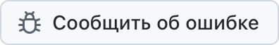

  <picture>
    <source media="(prefers-color-scheme: dark)" srcset="../../assets/app-icon-dark.png">
    
  </picture>

<h1 align="center">super.engineering</h1>

Сообщения об ошибках и запросы функций для super.engineering.

  
  

[super.engineering](https://super.engineering) — нативная рабочая среда для агентной разработки. Она объединяет ваших агентов для программирования, терминалы и ревью в одном сверхбыстром приложении, написанном на Rust. Расскажите, что не работает и что вам нужно дальше.

  <a href="https://github.com/superdoteng/super.engineering/issues/new?template=bug.yml"><picture><source media="(prefers-color-scheme: dark)" srcset="../../assets/buttons/bug-ru-RU-dark.png"></picture></a>
  <a href="https://github.com/superdoteng/super.engineering/issues/new?template=feature.yml"><picture><source media="(prefers-color-scheme: dark)" srcset="../../assets/buttons/feature-ru-RU-dark.png"></picture></a>

## Что указать

Используете агента? Прочитайте [руководство для агентов](../../AGENTS.md).

[Сначала поищите среди существующих обращений](https://github.com/superdoteng/super.engineering/issues). Добавьте полезные сведения к подходящему сообщению.

- **Ошибка:** шаги для воспроизведения, ожидаемый результат и то, что произошло. Если можете, укажите версию приложения из окна «О приложении super.engineering» и вашу операционную систему.
- **Функция:** ваша задача, что мешает её выполнить и какой результат вам нужен.
- **Логи и снимки экрана:** по желанию. Сначала проверьте, нет ли в них личной информации, или отправьте их на [humans@super.engineering](mailto:humans@super.engineering).

## Нужна помощь?

Задавайте вопросы и делитесь идеями в [Discord](https://discord.gg/AJ5BUZSV65).\
О проблемах безопасности сообщайте конфиденциально на [humans@super.engineering](mailto:humans@super.engineering).

  <a href="ar.md">العربية</a> ·
  <a href="bn-BD.md">বাংলা</a> ·
  <a href="de-DE.md">Deutsch</a> ·
  <a href="../../README.md">English</a> ·
  <a href="es-ES.md">Español</a> ·
  <a href="fa-IR.md">فارسی</a> ·
  <a href="fr-FR.md">Français</a> ·
  <a href="he-IL.md">עברית</a> ·
  <a href="hi-IN.md">हिन्दी</a> ·
  <a href="id-ID.md">Bahasa Indonesia</a> ·
  <a href="it-IT.md">Italiano</a> ·
  <a href="ja-JP.md">日本語</a> ·
  <a href="ko-KR.md">한국어</a> ·
  <a href="pt-BR.md">Português (Brasil)</a> ·
  <strong>Русский</strong> ·
  <a href="tr-TR.md">Türkçe</a> ·
  <a href="ur-PK.md">اردو</a> ·
  <a href="vi-VN.md">Tiếng Việt</a> ·
  <a href="zh-CN.md">简体中文</a> ·
  <a href="zh-TW.md">繁體中文</a>

