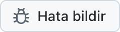
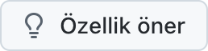

  <picture>
    <source media="(prefers-color-scheme: dark)" srcset="../../assets/app-icon-dark.png">
    
  </picture>

<h1 align="center">super.engineering</h1>

super.engineering için hata bildirimleri ve özellik istekleri.

  
  

[super.engineering](https://super.engineering), ajan tabanlı mühendislik için yerel çalışma alanıdır. Kodlama ajanlarınızı, terminallerinizi ve incelemelerinizi Rust ile geliştirilmiş tek bir son derece hızlı uygulamada bir araya getirir. Neyin bozulduğunu ve sırada neye ihtiyacınız olduğunu bize söyleyin.

  <a href="https://github.com/superdoteng/super.engineering/issues/new?template=bug.yml"><picture><source media="(prefers-color-scheme: dark)" srcset="../../assets/buttons/bug-tr-TR-dark.png"></picture></a>
  <a href="https://github.com/superdoteng/super.engineering/issues/new?template=feature.yml"><picture><source media="(prefers-color-scheme: dark)" srcset="../../assets/buttons/feature-tr-TR-dark.png"></picture></a>

## Neler yazılmalı?

Bir ajan mı kullanıyorsunuz? [ajan rehberini](../../AGENTS.md) okuyun.

[Önce mevcut bildirimleri arayın](https://github.com/superdoteng/super.engineering/issues). Eşleşen bir bildirime yararlı ayrıntılar ekleyin.

- **Hata:** yeniden oluşturma adımları, beklediğiniz sonuç ve gerçekte ne olduğu. Mümkünse “super.engineering hakkında” bölümündeki uygulama sürümünü ve işletim sisteminizi ekleyin.
- **Özellik:** yapmak istediğiniz iş, önünüzdeki engel ve ihtiyacınız olan sonuç.
- **Günlükler ve ekran görüntüleri:** isteğe bağlıdır. Önce özel bilgi içerip içermediklerini kontrol edin ya da [humans@super.engineering](mailto:humans@super.engineering) adresine e-postayla gönderin.

## Yardıma mı ihtiyacınız var?

[Discord](https://discord.gg/AJ5BUZSV65) üzerinde soru sorun ve fikirlerinizi paylaşın.\
Güvenlik sorunlarını [humans@super.engineering](mailto:humans@super.engineering) adresine gizli olarak bildirin.

  <a href="ar.md">العربية</a> ·
  <a href="bn-BD.md">বাংলা</a> ·
  <a href="de-DE.md">Deutsch</a> ·
  <a href="../../README.md">English</a> ·
  <a href="es-ES.md">Español</a> ·
  <a href="fa-IR.md">فارسی</a> ·
  <a href="fr-FR.md">Français</a> ·
  <a href="he-IL.md">עברית</a> ·
  <a href="hi-IN.md">हिन्दी</a> ·
  <a href="id-ID.md">Bahasa Indonesia</a> ·
  <a href="it-IT.md">Italiano</a> ·
  <a href="ja-JP.md">日本語</a> ·
  <a href="ko-KR.md">한국어</a> ·
  <a href="pt-BR.md">Português (Brasil)</a> ·
  <a href="ru-RU.md">Русский</a> ·
  <strong>Türkçe</strong> ·
  <a href="ur-PK.md">اردو</a> ·
  <a href="vi-VN.md">Tiếng Việt</a> ·
  <a href="zh-CN.md">简体中文</a> ·
  <a href="zh-TW.md">繁體中文</a>

