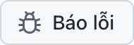

  <picture>
    <source media="(prefers-color-scheme: dark)" srcset="../../assets/app-icon-dark.png">
    
  </picture>

<h1 align="center">super.engineering</h1>

Báo lỗi và yêu cầu tính năng cho super.engineering.

  
  

[super.engineering](https://super.engineering) là không gian làm việc gốc dành cho kỹ thuật phần mềm dựa trên tác nhân. Nó gom các tác nhân lập trình, terminal và phần review của bạn vào một ứng dụng siêu nhanh, được viết bằng Rust. Hãy cho chúng tôi biết điều gì bị lỗi và bạn cần gì tiếp theo.

  <a href="https://github.com/superdoteng/super.engineering/issues/new?template=bug.yml"><picture><source media="(prefers-color-scheme: dark)" srcset="../../assets/buttons/bug-vi-VN-dark.png"></picture></a>
  <a href="https://github.com/superdoteng/super.engineering/issues/new?template=feature.yml"><picture><source media="(prefers-color-scheme: dark)" srcset="../../assets/buttons/feature-vi-VN-dark.png"></picture></a>

## Nội dung cần cung cấp

Bạn đang dùng tác nhân? Hãy đọc [hướng dẫn dành cho tác nhân](../../AGENTS.md).

[Tìm trong các issue hiện có trước](https://github.com/superdoteng/super.engineering/issues). Bổ sung thông tin hữu ích vào báo cáo phù hợp.

- **Lỗi:** các bước tái hiện, kết quả mong đợi và điều thực sự xảy ra. Nếu có thể, hãy thêm phiên bản ứng dụng trong “Giới thiệu về super.engineering” và hệ điều hành bạn đang dùng.
- **Tính năng:** công việc của bạn, trở ngại và kết quả bạn cần.
- **Nhật ký và ảnh chụp màn hình:** không bắt buộc. Hãy kiểm tra thông tin riêng tư trước, hoặc gửi email đến [humans@super.engineering](mailto:humans@super.engineering).

## Cần trợ giúp?

Đặt câu hỏi và chia sẻ ý tưởng trên [Discord](https://discord.gg/AJ5BUZSV65).\
Báo cáo vấn đề bảo mật một cách riêng tư tới [humans@super.engineering](mailto:humans@super.engineering).

  <a href="ar.md">العربية</a> ·
  <a href="bn-BD.md">বাংলা</a> ·
  <a href="de-DE.md">Deutsch</a> ·
  <a href="../../README.md">English</a> ·
  <a href="es-ES.md">Español</a> ·
  <a href="fa-IR.md">فارسی</a> ·
  <a href="fr-FR.md">Français</a> ·
  <a href="he-IL.md">עברית</a> ·
  <a href="hi-IN.md">हिन्दी</a> ·
  <a href="id-ID.md">Bahasa Indonesia</a> ·
  <a href="it-IT.md">Italiano</a> ·
  <a href="ja-JP.md">日本語</a> ·
  <a href="ko-KR.md">한국어</a> ·
  <a href="pt-BR.md">Português (Brasil)</a> ·
  <a href="ru-RU.md">Русский</a> ·
  <a href="tr-TR.md">Türkçe</a> ·
  <a href="ur-PK.md">اردو</a> ·
  <strong>Tiếng Việt</strong> ·
  <a href="zh-CN.md">简体中文</a> ·
  <a href="zh-TW.md">繁體中文</a>

